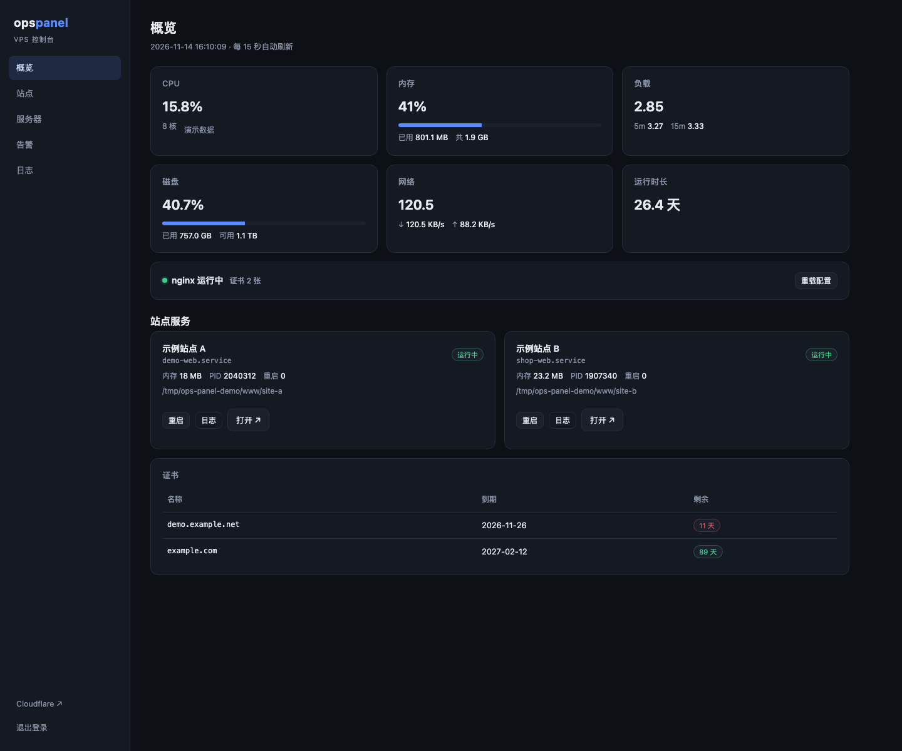
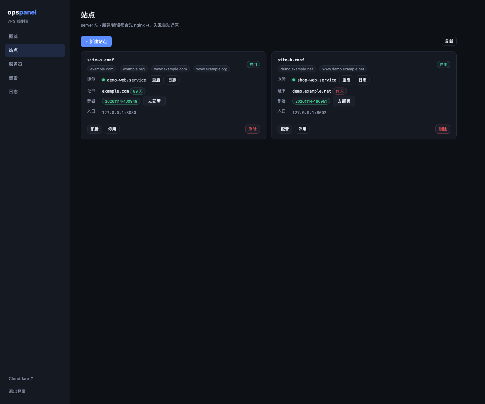
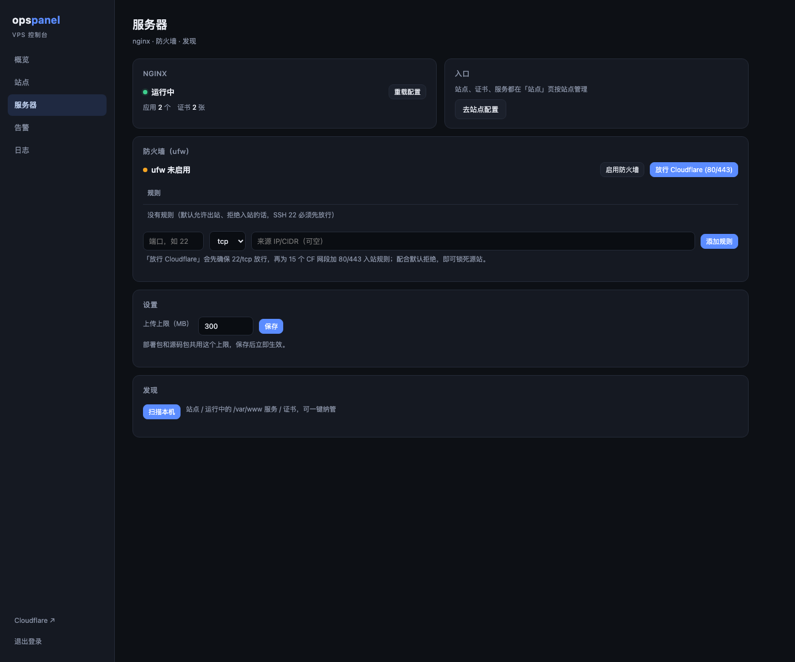
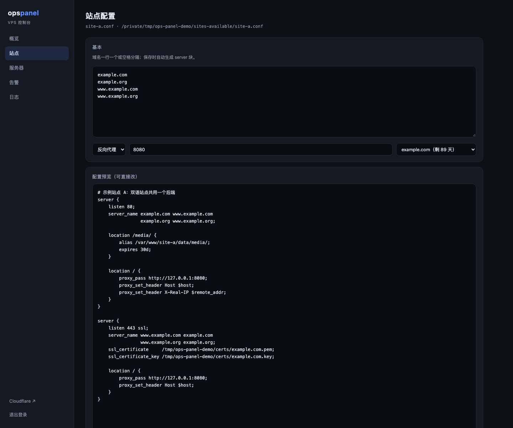

# ops-panel

一台 VPS、一个面板：**Nginx 站点 / 证书 + systemd 服务 + 部署回滚**。
纯 Python 标准库，无 pip、无 Node、无 Docker，不接管 nginx、不改现有架构。

## 界面






## 它解决什么

| 原来 | 现在 |
|---|---|
| SSH 改 nginx 配置，改错要自己回滚 | 网页里编辑，保存前 `nginx -t`，失败自动还原 |
| 证书靠 scp，忘了哪张快过期 | 网页上传 pem/key（自动校验是否配对），列表看到期天数 |
| `systemctl restart` 记不住、日志要翻 journal | 点按钮重启，抽屉里看日志 |
| 手工 tar.gz + 解包 + 改属主 | Mac 上一条命令，服务器端备份、同步、重启、健康检查、失败自动回滚 |
| SSH 看 CPU/内存、敲 ufw | 概览页 CPU/内存/负载/磁盘/网络卡片；服务器页 ufw 规则增删、一键放行 Cloudflare 80/443 |
| 菜单散：服务/证书/部署各一页 | 以站点为中心：站点卡片直接显示关联的服务状态、证书、最近部署；菜单只有 概览/站点/服务器/告警/日志 |

## 新建站点（向导）

站点页「新建站点」一处填完，自动做完这些事：

1. 填域名（多个）、类型（反代 / 静态）
2. 选源码包（zip / tar.gz，可留空）和部署路径（默认 `/var/www/<站点名>`）
3. 反代模式填端口；端口没有对应服务时，填启动命令，面板自动建目录 + systemd 单元并启动
4. 选证书（可留空），自动生成 80 + 443 两个 server 块
5. 源码包自动解压到部署路径、改属主；nginx -t 通过才生效

装好的站点在列表里按卡片展示，点「配置」进入站点配置页：域名、类型、端口/目录、证书选择、配置预览与在线修改，以及关联服务的重启/日志/部署入口。

## 站点与发现

- **新建站点**：反向代理（填端口）或静态目录（填根目录），域名支持一行一个/空格/逗号，多个域名写同一个 server 块
- **编辑**：原始 server 块，保存前 `nginx -t`，失败自动还原
- **启停**：切换 `sites-enabled` 软链接，不动文件本身
- **删除**：先备份到 `backups/nginx/deleted-*`；可选同时删除 systemd 单元和网站目录（目录删除需输入站点名确认；端口或路径被其他站点共用时会拒绝）
- **发现**：扫描 `sites-enabled/available`、运行中的 `/var/www` 服务、`/etc/ssl/cloudflare`、`/etc/letsencrypt/live`；未纳管的服务可一键加入面板
- **新 VPS**：站点向导里填端口和启动命令，自动建目录 + systemd 单元；之后用 `deploy.sh` 推代码

## 告警与日报

在面板「告警」页填写，或改 `config.json` 的 `notify` 段：

| 字段 | 说明 |
|---|---|
| `base_url` | RemindHub 业务地址，如 `http://10.0.0.10:9095`（不是 9096 控制台） |
| `token` | App Token，面板会隐藏显示 |
| `channels` | 留空 = 发给该接入方全部通道（推荐） |
| `daily_at` | 日报时间，默认 `09:00` |
| `heartbeat_name` | 可选。填 RemindHub「巡检」里建的名字，每轮巡检后报活；面板挂了会触发"该来没来" |

### 告警矩阵

| 类别 | 触发条件 | 默认阈值 | 方式 |
|---|---|---|---|
| 网站可用性 | HTTP 非 2xx/3xx，连续 N 次 | 2 次 | 即时推送 + 恢复推送 |
| systemd 服务 | `is-active` 非 active | 同上 | 即时 + 恢复 |
| nginx | 进程不在 active | — | 状态切换时推送 |
| 证书 | 剩余天数 ≤ 阈值 | 14 天 | 每张每天一次 |
| 磁盘 | 根分区使用率 ≥ 阈值 | 85% | 越过阈值时一次 |
| 内存 | 使用率 ≥ 阈值 | 90% | 越过阈值时一次 |
| 负载 | 1 分钟负载 > 核数 × 倍数，连续 3 次 | 2 倍 | 触发时一次 |
| 部署 | 部署失败 / 自动回滚 | — | 即时推送 |
| 日报 | 每天固定时间汇总 | 09:00 | 一条 |

日报内容：各站可用率（成功/总检查数）、故障次数、nginx 状态、磁盘、证书剩余、最近告警。

推送走 `POST /api/reminders`，key 形如 `opspanel:incident:site-down:<hash>:<时间>`，同一事件不会重复轰炸；恢复用 `opspanel:recovery:...`。

## 结构

```
panel.py              单文件后端（标准库 HTTPServer）
web/                  前端（原生 JS，无构建）
install.sh            服务器端安装（生成密码、systemd 单元、启动）
deploy.sh             本机发版脚本（打包含排除）
config.example.json   配置模板（apps 为空，装好后用「发现」或向导添加）
```

## 安装（服务器，root）

**从 GitHub（推荐）**：

```bash
apt update && apt install -y git
git clone --depth 1 https://github.com/lwhsyy123/ops-panel.git /opt/ops-panel-src
bash /opt/ops-panel-src/install.sh
```

或者用 bootstrap（仓库地址用环境变量传）：

```bash
OPS_PANEL_REPO=https://github.com/lwhsyy123/ops-panel.git bash bootstrap.sh
```

**离线包**：

```bash
scp -r ops-panel root@<IP>:/root/
ssh root@<IP>
bash /root/ops-panel/install.sh
```

完整的发布、首次配置、更新与卸载见 [DEPLOY.md](DEPLOY.md)；本地自检结果见 [docs/SELF-CHECK.md](docs/SELF-CHECK.md)。

安装完会打印：面板密码、部署令牌、隧道命令。密码同时存在 `/root/.ops-panel-password`。

## 访问（四选一）

| 方式 | 适用 |
|---|---|
| SSH 隧道 | 默认，最安全，不开任何端口 |
| nginx 反代 + HTTPS | 想直接用域名打开，面板仍留本机 |
| 直连 IP:9100 | 不推荐；需 2FA + TLS + IP 白名单 |
| Cloudflare Tunnel + Access | 不开端口、带邮箱验证、手机可用 |

详细步骤（含 nginx 配置、cloudflared 命令、Access 策略）见 [DEPLOY.md 第五节](DEPLOY.md)。

SSH 隧道最短路径：

```bash
ssh -N -L 9100:127.0.0.1:9100 root@<IP>
```

浏览器打开 `http://127.0.0.1:9100`。

## 部署

本机（Mac）：

```bash
cd ~/code/my-site
OPS_HOST=root@<IP> OPS_TOKEN=<令牌> ~/ops-panel/deploy.sh my-site .
```

服务器端流程：

1. 上传的包解到 `state_dir/staging`
2. 把当前版本打成临时备份 `releases/<app>-<时间>-prev.tgz`（排除 `data/`）
3. `rsync -a --delete` 覆盖，排除 `data`、`.git`、`__pycache__` 等
4. `chown -R www-data:www-data`
5. `systemctl restart <unit>`
6. 健康检查 `health_url`（GET，最多 6 次 × 2 秒）
7. 成功：把**部署后的状态**打成快照 `releases/<app>-<时间>.tgz`，作为这个版本的回滚点，删掉临时备份
8. 失败：用临时备份还原 → 改属主 → 重启 → 记录失败

历史在面板「部署」页，回滚就是把对应版本的快照 rsync 回目录（默认保留 5 个快照）。

## 安全设计

- 默认只监听 `127.0.0.1`；要公网访问推荐 nginx 反代 + HTTPS 或 Cloudflare Tunnel（见 DEPLOY.md）
- 密码 PBKDF2-SHA256（20 万次），支持 TOTP 两步验证 + 8 个一次性恢复码
- 安全页可修改密码、重置部署令牌；改密码会踢掉所有会话
- 会话 Cookie `HttpOnly + SameSite=Strict`
- 所有时间戳统一北京时间（Asia/Shanghai）
- 登录失败 5 次锁 5 分钟
- 所有写操作要求 `X-Ops: 1` 头（CSRF）
- 站点编辑：先备份 → 写临时文件 → `nginx -t` → 失败还原
- 部署包路径校验，拒绝绝对路径和符号链接
- 操作审计写 `/var/log/ops-panel/audit.log`

## 限制

- 不做 ACME 签发。Cloudflare Origin 证书手动上传即可（15 年免续）
- 不管防火墙，ufw 仍走命令行
- 单管理员账号，无多用户/2FA（v1）
- 站点删除被禁用，避免误删直接断站

## 系统要求与兼容性

| 环境 | 状态 | 说明 |
|---|---|---|
| Ubuntu 20.04 / 22.04 / 24.04 | ✅ | 主要目标环境，nginx 默认就是 sites-available/enabled 布局 |
| Debian 11 / 12 | ✅ | 同 Ubuntu |
| RHEL 8/9、Rocky、AlmaLinux | ⚠️ | systemd/nginx 可用；但面板的防火墙模块只支持 ufw（firewalld 不识别），SELinux 需 `setsebool -P httpd_can_network_connect 1`，nginx 目录布局要改成 Debian 风格或在 config 里改路径 |
| Alpine / OpenRC、FreeBSD | ❌ | 没有 systemd，服务管理不可用 |
| nginx 跑在 Docker 里 | ❌ | 面板管理的是宿主机的 nginx 与 systemd |

其他要求：Python 3.8+（只用标准库）、root 权限、80/443 由宿主机 nginx 占用。面板只监听 `127.0.0.1`，通过 SSH 隧道访问。

## 配置说明

`/etc/ops-panel/config.json`：

| 字段 | 说明 |
|---|---|
| `apps[].unit` | systemd 单元名，也是面板允许操作的白名单 |
| `apps[].path` | 部署目标目录 |
| `apps[].exclude` | rsync 排除项，**`data` 必须在里面** |
| `apps[].health_url` | 部署后探测的地址，失败触发回滚 |
| `deploy_token` | deploy.sh 使用的令牌，泄露就换一个 |
| `max_upload_mb` | 上传包大小上限，默认 300（MB），改完重启面板 |

改完配置：`systemctl restart ops-panel`。
